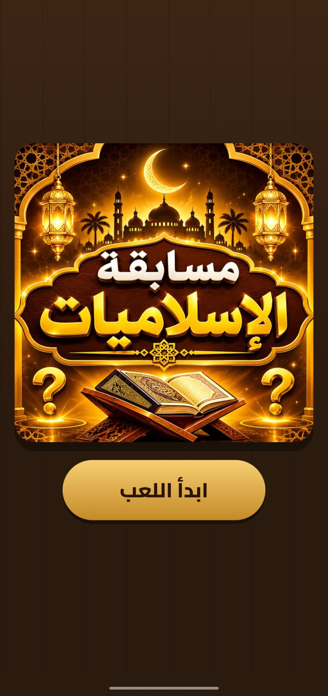
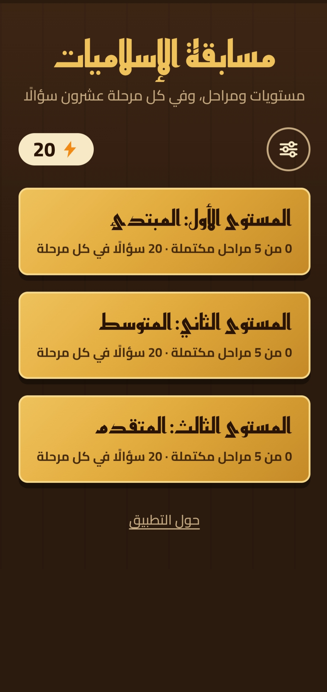
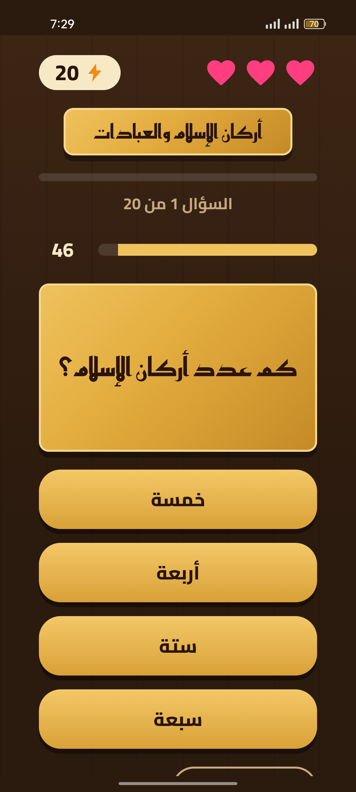
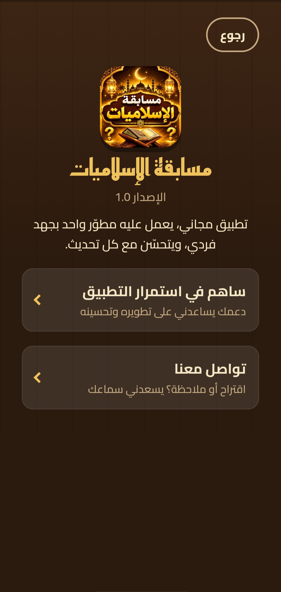
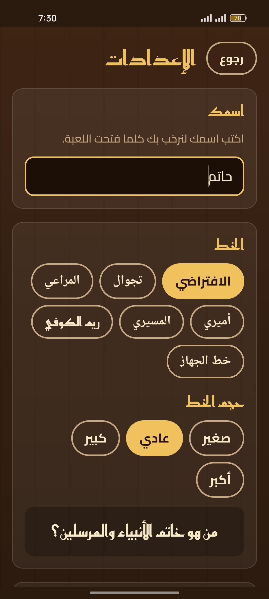
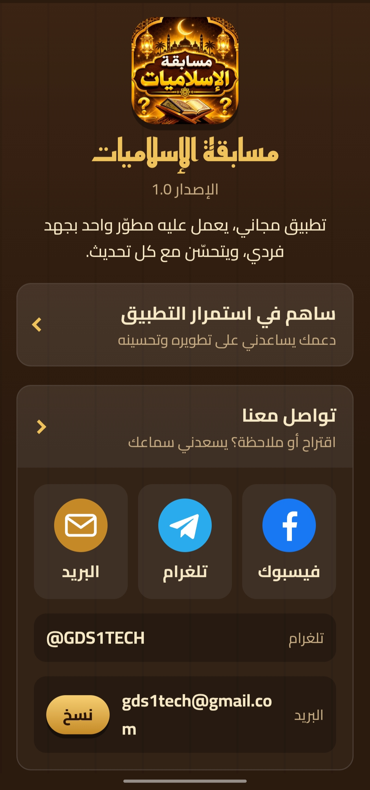

<!-- إذا أردت إظهار الأيقونة، ارفع ملف icon.jpg أولاً أو احذف السطر التالي -->
<!--  -->

# مسابقة الإسلاميات
### Islamic Quiz

لعبة أسئلة إسلامية بالعربية لأندرويد، مجانية.

[⬇️ تحميل أحدث إصدار (APK)](https://github.com/HatimAli-Bashir/islamic-quiz/releases/latest)

  

  

## المميزات
- 3 مستويات و15 مرحلة، في كل مرحلة 20 سؤالاً (300 سؤال).
- 3 قلوب لكل مرحلة، و10 نقاط لكل إجابة صحيحة، ونجوم حسب أدائك.
- المراحل تُفتح تدريجياً.
- مؤقت لكل سؤال يمكن تغييره أو إيقافه.
- أصوات وموسيقى هادئة يمكن إيقافها.
- اختيار الخط وحجمه، وترحيب باسمك.
- واجهة عربية كاملة.

## التثبيت
1. حمّل ملف `app-release-signed.apk` من صفحة Releases.
2. اسمح بالتثبيت من هذا المصدر عند الطلب.
3. إن ظهر تحذير Play Protect فسببه أن التطبيق غير منشور في المتجر، فاختر التثبيت على أي حال.

## دعم واستمرار التطبيق
هذا التطبيق مجاني بالكامل ويعمل عليه مطور فردي بشغف لإضافة أسئلة ومراحل وتحديثات جديدة باستمرار دون إعلانات مزعجة. إذا أعجبك التطبيق واستفدت منه، فمساهمتك—مهما كانت بسيطة—تساعد في تطويره والحفاظ عليه مجانياً للجميع.

- **اسم المستخدم:** `HATEM GDS`
- **Binance ID:** `1252557005`

## تواصل
- تلغرام: @GDS1TECH
- gds1tech@gmail.com
- الملاحظات والاقتراحات: تبويب Issues

© 2026 GDS TECH. جميع الحقوق محفوظة.

